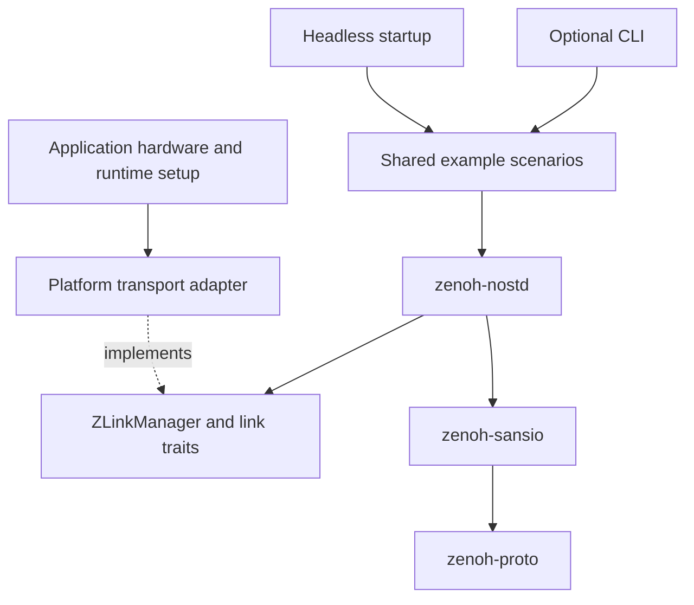

# Architecture and porting

`zenoh-nostd` is an async Rust library with `no_std` and fixed-capacity storage
by default. Applications choose the hardware, networking, runtime, and memory
configuration. MCU support depends on satisfying these requirements, rather
than selecting a board feature in the library.

## Code map

| Location | Responsibility |
| --- | --- |
| [crates/zenoh-derive](../crates/zenoh-derive/) | Derive and helper macros |
| [crates/zenoh-proto](../crates/zenoh-proto/) | Protocol messages, encoding, endpoints, and key expressions |
| [crates/zenoh-sansio](../crates/zenoh-sansio/) | Protocol state machines independent of network I/O |
| [crates/zenoh-nostd](../crates/zenoh-nostd/) | Async sessions, pub/sub/query APIs, storage, transport driving, and optional broker |
| [platforms/](../platforms/) | Transport adapters: host sockets, browser WebSockets, and Embassy networking |
| [examples/common](../examples/common/) | Example configuration, typed scenarios, and optional `embedded-cli` frontend |
| [examples/embassy](../examples/embassy/) | Shared MCU startup/USB helpers and independent board applications |
| [examples/native](../examples/native/), [examples/wasm](../examples/wasm/) | Host and browser applications |

The root is a virtual workspace containing the four core crates. Adapters and
example projects have their own manifests, lockfiles, and workspaces to isolate
target requirements and Cargo feature selection.

The CLI, scenarios, console drivers, and HAL dependencies stay in `examples/`.
A production application can call the session API directly.

## Application contract

- **Transport and network:** provide a `ZLinkManager` and links, or use an
  adapter. `zenoh-embassy` borrows an initialized `embassy_net::Stack`; the
  application brings up Wi-Fi/Ethernet and DHCP. `EmbeddedIOLink` can wrap split
  async readers/writers; connection management is still application-owned.
- **Execution and time:** continuously poll the session driver alongside
  operations, and provide an Embassy-compatible time driver. The core uses
  Embassy futures, synchronization, and timers without selecting an executor
  architecture. An unpolled driver cannot receive traffic or maintain a session.
- **Entropy:** bare-metal builds enable `zenoh-nostd/embedded`; the final binary
  registers a `getrandom` 0.2 custom backend backed by suitable entropy. The
  feature alone does not provide the implementation.
- **Memory:** implement `ZSessionConfig` for buffers and callback capacities.
  Enabling `alloc` requires an application-owned global allocator. Network/HAL
  dependencies may require a heap even when Zenoh uses fixed storage.
- **Synchronization:** current sessions/drivers/brokers use `NoopRawMutex`.
  Keep access in one executor/thread context; this is not cross-core or
  interrupt-safe shared storage.
- **Firmware:** the application owns entry points, panic/logging handlers,
  critical-section support, target/toolchain configuration, linker scripts,
  and the flash runner.

See [ExampleConfig](../examples/common/src/lib.rs), the
[session configuration trait](../crates/zenoh-nostd/src/config.rs), and the
[scenario runner](../examples/common/src/scenarios/runner.rs) for working code.
For reusable connections, `SessionSlot` provides pinned session storage with
guard-bounded access. Its guard drops the driver before the borrowed transport.
Keep receive callbacks short; copy bounded data for later reporting instead of
waiting for console output inside a callback.

## Library features

| Feature | Effect |
| --- | --- |
| default (empty) | `no_std`, fixed-capacity storage |
| `alloc` | Heap-backed storage and broker API; does not enable `std` |
| `std` | Standard-library support in core/protocol dependencies |
| `embedded` | Custom randomness backend path; implementation supplied by the application |
| `log`, `defmt`, `web_console` | Logging backend choices; `web_console` also enables `std` |

Use `default-features = false` on library dependencies and choose one logging
backend per application. The `cli` and `console-usb` features belong to examples.

`zenoh-embassy` enables TCP and UDP by default. Select `medium-ip` or
`medium-ethernet` for the device, and enable DHCP in the application's
`embassy-net` dependency if needed. The adapter currently uses IPv4 socket
addresses; UDP listening is not implemented. Browser applications use WebSockets
and cannot listen or run the broker. Serial network transport is not implemented;
UART/USB consoles are command interfaces.

## Add an MCU target

1. Start from a similar [board project](../examples/embassy/README.md). Create
   `examples/embassy/<family>/<board>/` with its own `[workspace]`, manifest,
   lockfile, and root workspace `exclude` entry.
2. Configure the HAL, network device, executor/time driver, entropy, memory,
   linker, and runner in that project. Select the smallest adapter feature set
   needed by the application.
3. Reuse `examples/common` for scenarios and its optional CLI. Reuse
   `examples/embassy/headless.rs` for startup scenarios and `usb_console.rs`
   when the board has an `embassy-usb` driver. Keep board pins and peripherals
   in its application; share family-specific setup under the family directory.
4. Keep `cli` enabled by default, UART as the embedded console default, and
   `alloc` independent. Add `console-usb` only when supported; it enables `cli`.
5. Add build/flash recipes to [examples/justfile](../examples/justfile), headless
   checks to [check_headless.py](../examples/common/check_headless.py), and
   release links to [CI](../.github/workflows/ci.yml). Adjust recipe board routing
   when adding a new family. Document console wiring and recovery beside the board.
6. Check fixed/allocated CLI and headless builds, plus supported USB variants.
   Link release firmware as well as running `cargo check`; then perform the
   [hardware smoke test](applications.md#hardware-smoke-test) when a board is available.

Run Cargo **from the target project directory**: `--manifest-path` alone does
not load that project's `.cargo/config.toml`. ESP32-S3 uses `cargo +esp`; C6 and
STM32 use stable Rust. Use release builds for S3 firmware; its board guide
documents the pinned toolchain's debug-link limitation.
